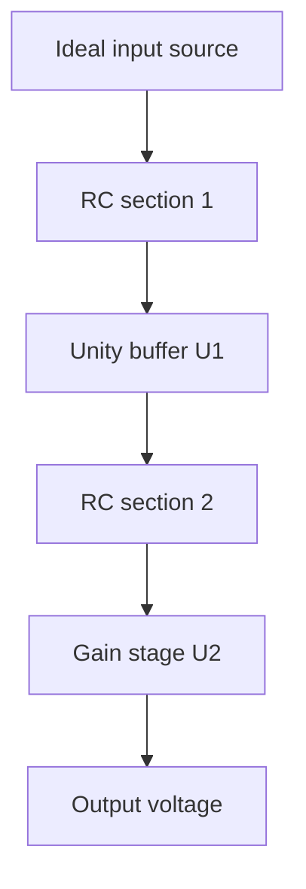

# Architecture and calculations

## Circuit and pipeline

`circuit.py` defines parameters, the original op-amp subcircuit and reference equations. `simulate.py` writes netlists under build/, invokes ngspice as an ordinary process, parses its exported data and checks the results. It saves a report and CSVs. `plot.py` creates the standalone evidence figure from that report. `build.mjs` copies public presentation files and evidence into public/. The website reads report.json; its separate JavaScript equations predict user-selected settings. No server executes SPICE or Python.

## Transfer equations

Let s=j2πf, A(s)=A0/(1+s A0/(2π GBW)), β=Rg/(Rf+Rg), Pi(s)=1/(1+s RiCi). The closed-loop op-amp transfers are C1=A/(1+A) and C2=A/(1+βA). The whole chain is H=P1 C1 P2 C2. These equations are independent of the ngspice numerical solver and test its complex output.

With ideal op-amps and equal RC values, H=G/(1+sRC)², where G=1+Rf/Rg. Each individual RC pole is at fp=1/(2πRC)=1591.55 Hz. At fp, each stage is down 3.0103 dB, so the combined response is down 6.0206 dB relative to passband. The whole chain's −3.0103 dB point is therefore fp*sqrt(sqrt(2)−1)=1024.31 Hz. This is a repeated-real-pole response, not a second-order Butterworth design.

In the RC-dominated stopband, slope approaches −40 dB/decade. Above the op-amp closed-loop bandwidths, their extra poles steepen it further. Finite A0 also reduces DC gain slightly.

## Noise budget

Let q=4kT, e be the specified op-amp input-voltage noise density, and Rp=Rf||Rg. With uncorrelated sources, output power density is:

Sout = q[R1|H|² + R2|P2 C2|² + Rp|C2|²] + e²[|C1 P2 C2|² + |C2|²].

The square root is output amplitude spectral density, in V/√Hz. R1's noise follows both filters; R2's follows only its own filter. Feedback-resistor and U2 input-noise contributions bypass those RC sections, explaining why the noise spectrum does not fall like the signal. Their finite amplifier bandwidth limits them at higher frequency. Never add independent amplitude densities directly; add squared densities first.

Noise RMS over [f1,f2] is sqrt(integral(Sout df)). The script applies trapezoids to actual SPICE density squared. Changing integration limits changes the reported RMS. Input-referred density divides output density by signal gain; it can increase in the stopband even while output density decreases.

## Implementation choices

Buffers make section equations and source attribution transparent. A generic original model avoids proprietary model licensing and makes all assumptions inspectable. A static site keeps deployment free of runtime simulation dependencies. The tradeoff is explicit: the preview predicts this mathematical circuit, rather than a selected real op-amp on a PCB. circuit.py and model.mjs are separate implementations checked against actual SPICE data.
