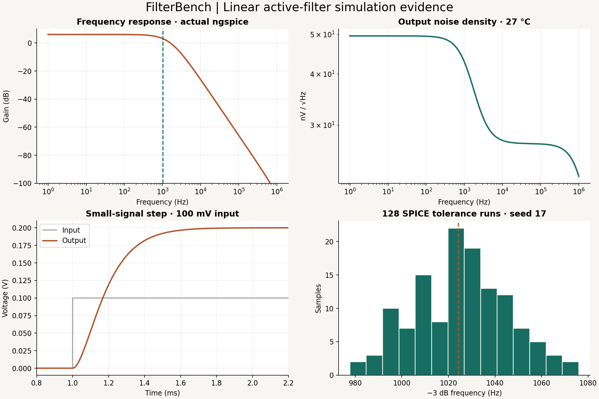

# FilterBench

Analog signal-conditioning project: two buffered RC low-pass sections followed by a noninverting gain stage. Includes actual ngspice frequency, transient and noise analyses; 128 component-tolerance runs; independent mathematical checks; and an interactive browser teaching lab.



## Run with free tools

Ubuntu / Debian / Windows WSL Ubuntu:

```sh
sudo apt-get update
sudo apt-get install -y ngspice make python3
make simulate
make test
```

`make simulate` runs nominal AC, transient and noise analyses plus 128 actual ngspice AC tolerance runs. It creates the report, CSVs, netlist, log and verification record. `make test` requires Node.js 22 or newer and compares the browser model against that actual report. On macOS, install `ngspice`, `node` and `python` using Homebrew. The recorded local engine was ngspice-39 on Linux; CI checks the Ubuntu-provided engine.

Optional evidence figure regeneration:

```sh
python3 -m pip install -r requirements.txt
make plot
```

Preview the site locally:

```sh
make site
python3 -m http.server 8080 --directory public
```

Open localhost:8080 in your browser. Vercel runs `node build.mjs` and publishes `public/`. There is no backend, database, authentication, paid API or environment secret.

## Recorded nominal results

| Quantity | Actual simulation / derived metric |
|---|---|
| Low-frequency gain | 1.99994 V/V; 6.02034 dB |
| Relative −3 dB bandwidth | 1024.23 Hz |
| Ideal repeated-RC cutoff | 1024.31 Hz |
| Output noise | 25.47 µV RMS, integrated 1 Hz–1 MHz |
| Step output | 199.994 mV for a 100 mV input |
| 1% settling time | about 0.666 ms after the input ramp reaches 100 mV |
| Tolerance sample cutoff range | 977.69–1075.99 Hz, 128 runs, seed 17 |

Sampling and interpolation choices are documented in VERIFICATION.md. These are simulated results from an explicitly limited linear model; no hardware measurements are claimed.

## What is inside

| File | Purpose |
|---|---|
| `circuit.py` | SPICE netlist generator and independent circuit/noise equations |
| `simulate.py` | Actual SPICE runs, assertions, metrics, seeded tolerance sampling |
| `nominal.cir` | Ready-to-run nominal ngspice circuit |
| `model.mjs`, `test-model.mjs` | Browser analytic model and agreement checks against real SPICE |
| `index.html`, `app.mjs` | Responsive demo, charts and JSON/netlist exports |
| `build.mjs` | Prepares public files without dependencies |
| `report.json` | Recorded simulation data, parameters, metrics and tolerance samples |
| `bode.csv`, `noise.csv`, `step.csv`, `tolerance.csv` | Exportable actual results |
| `plot.py`, `evidence.png`, `schematic.svg` | Reproducible figure and exact nominal signal-path diagram |
| `ngspice.log`, `verification.txt` | Actual nominal engine log and check results |
| `SPEC.md`, `ARCHITECTURE.md`, `VERIFICATION.md` | Design contract, equations and verification limits |
| `BEGINNER-GUIDE.md`, `INTERVIEW-GUIDE.md` | Learning and presentation guides |

## Keep simulated evidence and predictions distinct

The browser's adjustable curve is an analytic preview, not a live ngspice service. The orange reference and lower evidence panels use recorded actual simulations. Component sliders do not alter those recordings. Export a custom `.cir` file and run `ngspice -b filterbench-custom.cir` to obtain actual SPICE results for that custom design.

After source changes that affect the circuit or analyses, run `make simulate`, `make test` and optionally `make plot`. Commit source and updated evidence together. Local generated netlists and individual MC logs are under ignored `build/`; the seed and recorded component values reproduce each run. Future pushes trigger read-only CI and Vercel independently; CI does not gate production promotion.

## Scope and license

Original generic single-pole linear op-amps, finite A0 and GBW, specified white input-voltage noise, resistor thermal noise at 27 °C. No vendor-model accuracy, slew rate, rails, saturation, current/flicker noise, PCB effects, power consumption or hardware validation. Component tolerances are assumed independent uniform values; sampled range is not a worst-case bound. See SPEC.md for exact assumptions.

MIT; see LICENSE. ngspice and matplotlib are separately installed tools and are not bundled. Protocol/circuit references: the official ngspice manual at https://ngspice.sourceforge.io/docs/ngspice-manual.pdf. The simulator and circuit equations are not an AI model.
